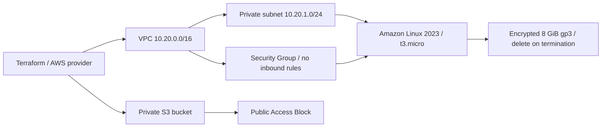
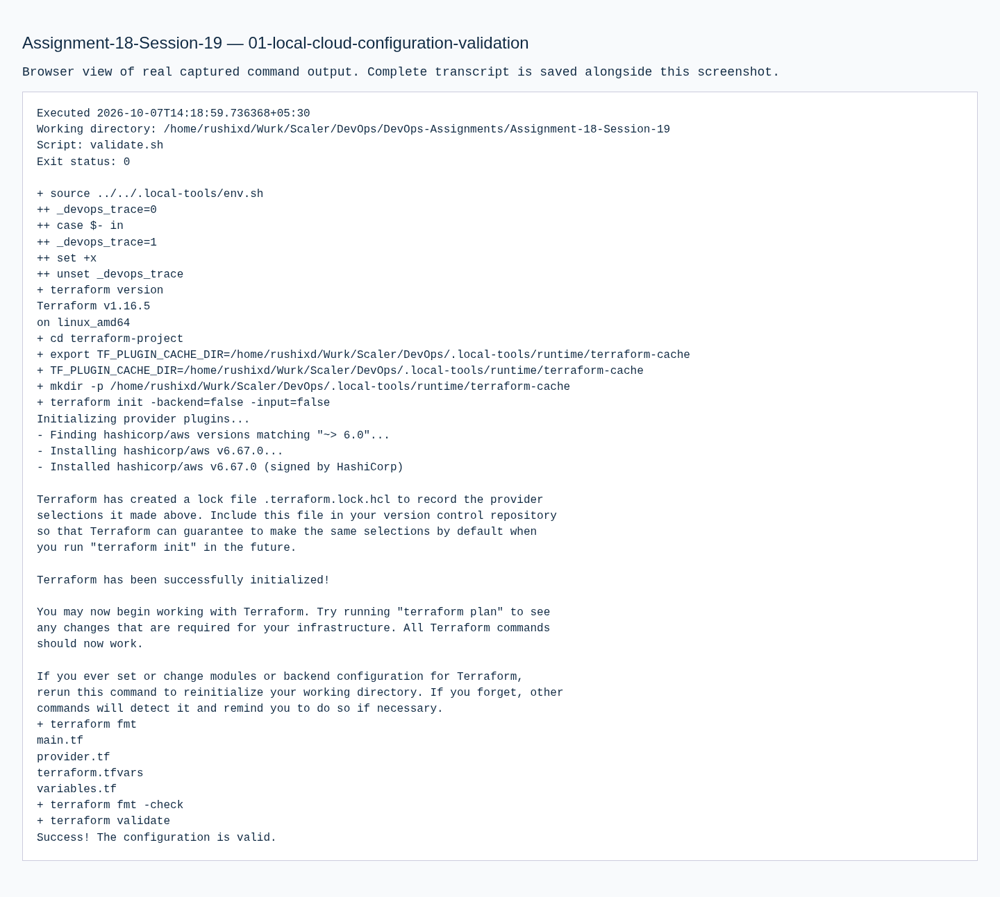
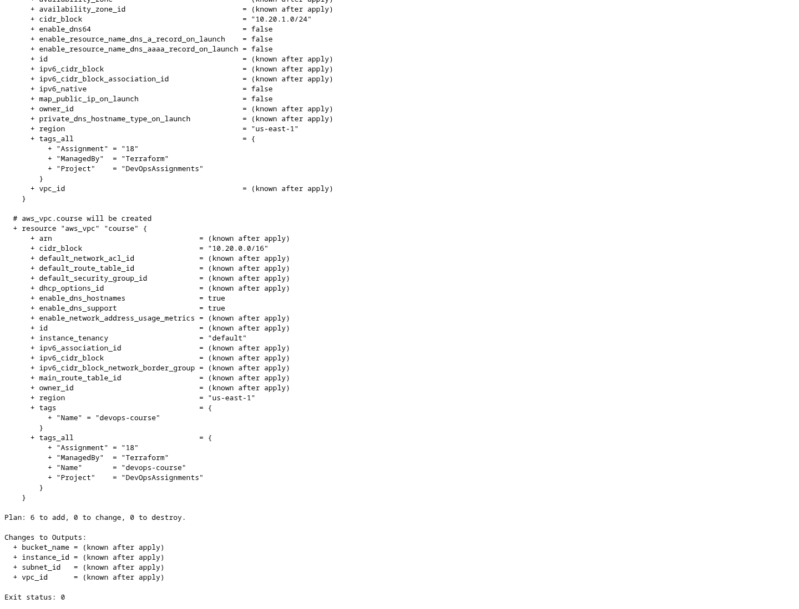
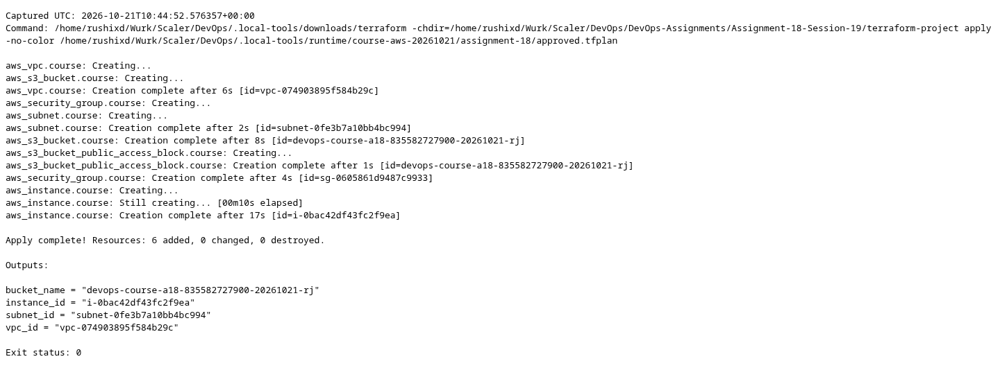
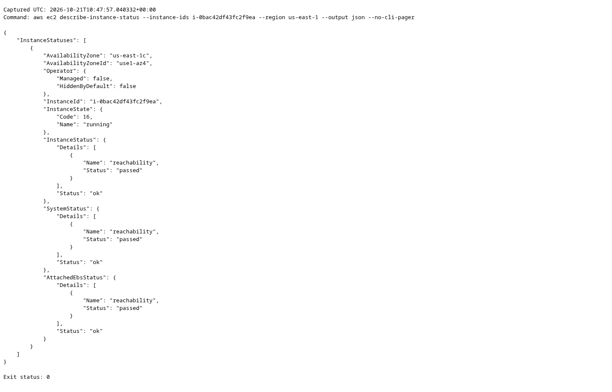
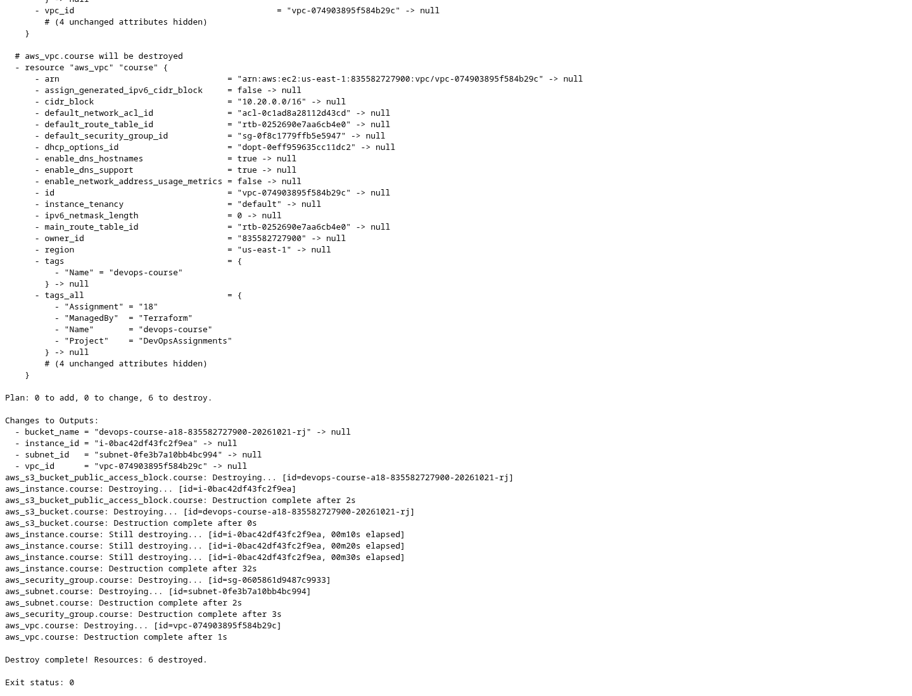

# Assignment 18 — Cloud & Terraform in Action

**Session 19 · COMPLETE · Real AWS lifecycle verified and cleaned up**

[Portfolio](../README.md) · [Exact PDF requirements](REQUIREMENTS.md) · [Terraform project](terraform-project/) · [Lifecycle result](evidence/aws-lifecycle-summary.json)

## Objective

Provision and verify a real AWS VPC, private subnet, Security Group, EC2 instance and protected S3 bucket with Terraform; demonstrate dependencies, outputs, state and teardown.

## Tasks performed

| Required work | Actual result |
| --- | --- |
| Terraform project | Required files exist in [terraform-project/](terraform-project/); provider lock retained. |
| Initialization and validation | Actual init, fmt, fmt -check and validate succeeded. |
| Plan and apply | 6 resources created in account `835582727900`, region `us-east-1` after explicit approval. |
| State and outputs | Actual `show`, `output -json` and `state list` captured; state itself stays private. |
| AWS verification | Bucket existence, public-access blocking and default encryption checked using AWS CLI. |
| Destroy and absence checks | All 6 managed resources destroyed; Terraform state is empty and the bucket is absent. |
| EC2 and network verification | Instance reached running with both status checks OK; VPC/subnet/SG/root-volume properties inspected. |

## Tools used

Terraform 1.16.5 · AWS provider 6.67.0 · AWS CLI 2.37.9 · host Bash/Python. Browser-based AWS CLI sign-in supplied temporary credentials; no access key or token is stored in this project.

## Implementation



| File | Responsibility |
| --- | --- |
| provider.tf | Local state backend, locked AWS provider, region and allowed-account guard |
| main.tf | AWS resources and reference-based dependencies |
| variables.tf | Typed region and resource inputs |
| outputs.tf | Values read from the created resources |
| terraform.tfvars | Actual nonsecret inputs used for this dated demonstration |
| terraform.tfvars.example | Input template for an independently approved rerun |
| .terraform.lock.hcl | AWS provider 6.67.0 dependency lock |

The provider restricts execution to the approved account. Terraform's local backend was initialized to a private runtime path outside both repositories; saved plans, state and plugin data were excluded from submission.

The instance has no public address, no Internet/NAT Gateway and no inbound Security Group rule. IMDSv2 is required; the encrypted 8 GiB root disk is deleted with the instance. Standard CPU credits avoid unlimited-mode surplus charges. This assignment verifies infrastructure; it does not claim a public application endpoint.

## Commands executed

The following are the executed Terraform operations, with the private runtime directory abbreviated as `$PRIVATE_RUNTIME`. The linked command records retain the exact paths and output.

```bash
terraform init -reconfigure -backend-config="path=$PRIVATE_RUNTIME/terraform.tfstate"
terraform fmt
terraform fmt -check
terraform validate
terraform plan -out="$PRIVATE_RUNTIME/approved.tfplan"
terraform apply "$PRIVATE_RUNTIME/approved.tfplan"
terraform show "$PRIVATE_RUNTIME/terraform.tfstate"
terraform output -json -state="$PRIVATE_RUNTIME/terraform.tfstate"
terraform state list -state="$PRIVATE_RUNTIME/terraform.tfstate"
terraform destroy -auto-approve -state="$PRIVATE_RUNTIME/terraform.tfstate"
terraform state list -state="$PRIVATE_RUNTIME/terraform.tfstate"
```

## Verification

| Check | Genuine command output |
| --- | --- |
| Init / format / validate | [Init](evidence/aws-init.txt) · [fmt](evidence/aws-fmt.txt) · [fmt check](evidence/aws-fmt-check.txt) · [validate](evidence/aws-validate.txt) |
| Resource plan | [Actual plan](evidence/aws-plan.txt) · [Structured plan summary](evidence/aws-plan-summary.json) |
| Creation | [Terraform apply](evidence/aws-apply.txt) |
| State / computed outputs | [show](evidence/aws-show.txt) · [output](evidence/aws-output.txt) · [state list](evidence/aws-state-list.txt) |
| Bucket protection | [Exists](evidence/aws-bucket-exists.txt) · [private access](evidence/aws-bucket-private.txt) · [encryption](evidence/aws-bucket-encryption.txt) |
| Teardown | [Destroy](evidence/aws-destroy.txt) · [empty state](evidence/aws-state-empty.txt) · [bucket absence](evidence/aws-bucket-removed.txt) |
| EC2 readiness | [Running](evidence/aws-instance-running.txt) · [both status checks OK](evidence/aws-instance-health.txt) |
| Actual infrastructure | [Instance](evidence/aws-ec2-instance.txt) · [VPC](evidence/aws-vpc.txt) · [subnet](evidence/aws-subnet.txt) · [security groups](evidence/aws-security-groups.txt) |
| Storage / CPU credits | [Encrypted root volume](evidence/aws-encrypted-root-volume.txt) · [standard credits](evidence/aws-standard-cpu-credits.txt) |
| Cloud absence | [Instance terminated](evidence/aws-instance-terminated.txt) · [VPC removed](evidence/aws-vpc-removed.txt) · [EBS root volume removed](evidence/aws-root-volume-removed.txt) |

[Infrastructure property assertions](evidence/aws-infrastructure-assertions.json) confirm the actual private address, IMDSv2, attached Security Group rules, encrypted disk and CPU-credit setting.

## Output / results

```json
{
  "bucket_name": "devops-course-a18-835582727900-20261021-rj",
  "instance_id": "i-0bac42df43fc2f9ea",
  "subnet_id": "subnet-0fe3b7a10bb4bc994",
  "vpc_id": "vpc-074903895f584b29c"
}
```

The full lifecycle ran from **2026-10-21T10:44:19.364444+00:00** to **2026-10-21T10:49:12.278058+00:00**, taking **292.9 seconds**. **Destroy succeeded; zero managed state objects remain.** The identifiers above are historical evidence, not running resources.

After deletion, the bucket existence check intentionally returns a nonzero not-found response. That expected absence, together with successful destroy and empty state, verifies cleanup; it is not an unhandled assignment failure.

## Screenshots

The following are real browser captures of the saved command-output files. They preserve actual AWS/Terraform results and are not mock terminal screens or fabricated console dashboards.











## Troubleshooting / observations

CLI authorization had to complete the browser approval callback before the temporary profile became available. The account/Free-plan check, reviewed resource plan and explicit lifecycle approval preceded apply. Local schema validation alone was not treated as evidence of AWS provisioning.

The account retained its Free plan; there was no account upgrade. Usage consumes existing credits and settled billing can lag. Saved plans/state and all runtime credentials remain outside Git.

## Lessons learned

References between resources establish Terraform dependencies. Outputs provide actual created IDs, while state maps those IDs to resource addresses. Plan review, resource inspection and verified teardown are distinct steps; successful syntax validation does not replace them.
