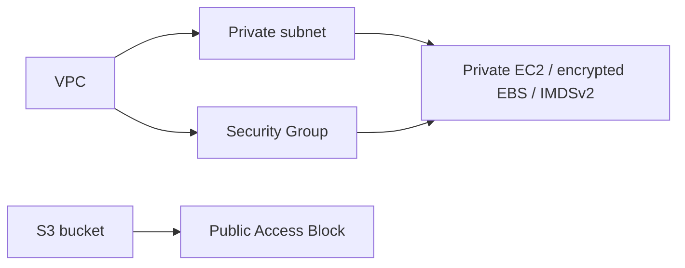

# Cloud Infrastructure · Terraform

[Assignment 18](../README.md) · [Variables](variables.tf) · [Outputs](outputs.tf)

> Prepare and validate VPC, private subnet, Security Group, private EC2 instance and protected S3 bucket. Real provisioning and teardown remain pending for this exact project.

## Configuration guide

| File | Responsibility |
| --- | --- |
| provider.tf | Terraform/provider version and region configuration |
| main.tf | Resource declarations and reference-based dependencies |
| variables.tf | Nonsecret input definitions |
| outputs.tf | Computed resource values, available after actual provisioning |
| terraform.tfvars | Public placeholders to replace before an approved plan |
| .terraform.lock.hcl | Verified provider dependency selection |

## Proposed architecture



This example declares a private subnet without an Internet/NAT Gateway, no public EC2 address and no inbound Security Group rule. It is an infrastructure exercise, not a claimed public web deployment.

## Executed local checks

```bash
terraform init -backend=false -input=false
terraform fmt
terraform fmt -check
terraform validate
```

The successful output is linked from the assignment README. These commands checked syntax and provider schemas; no real cloud state or resource result was produced.

## Remaining approved workflow

After choosing the approved account/region/resource inputs and reviewing the actual plan, the required remaining operations are plan, apply, inspect resources/outputs and destroy. Assignment 17 additionally explicitly requests terraform show/output. Capture genuine command output and screenshots, then record cleanup.

These cloud/state operations are **not yet executed here**. Keep credentials outside source and exclude real state, saved plans and secret-bearing output from the submission. A valid Terraform configuration is not evidence of a created resource.
