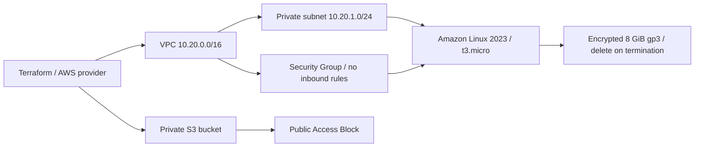

# Terraform AWS Infrastructure

[Assignment 18 — full workflow and evidence](../README.md) · [Variables](variables.tf) · [Outputs](outputs.tf)

This project completed a real approved AWS plan → apply → inspect state/outputs/resources → destroy lifecycle on 21 October 2026. All 6 Terraform resources were removed after verification. See the [actual lifecycle result](../evidence/aws-lifecycle-summary.json).

## Architecture

## Files

| File | Responsibility |
| --- | --- |
| provider.tf | Local state backend, locked AWS provider, region and allowed-account guard |
| main.tf | AWS resources and reference-based dependencies |
| variables.tf | Typed region and resource inputs |
| outputs.tf | Values read from the created resources |
| terraform.tfvars | Actual nonsecret inputs used for this dated demonstration |
| terraform.tfvars.example | Input template for an independently approved rerun |
| .terraform.lock.hcl | AWS provider 6.67.0 dependency lock |

## Workflow

Initialization, formatting, validation, saved plan, apply, show/output/state inspection and destroy were actually executed. The complete commands, recorded output and screenshots are embedded in the [assignment README](../README.md).

`terraform.tfvars` contains the actual nonsecret region/resource inputs used for this dated run. It contains no credentials. The local backend points to a private runtime directory supplied during initialization; real state and saved plans are excluded from Git. Any new resource lifecycle requires its own current plan and approval.
