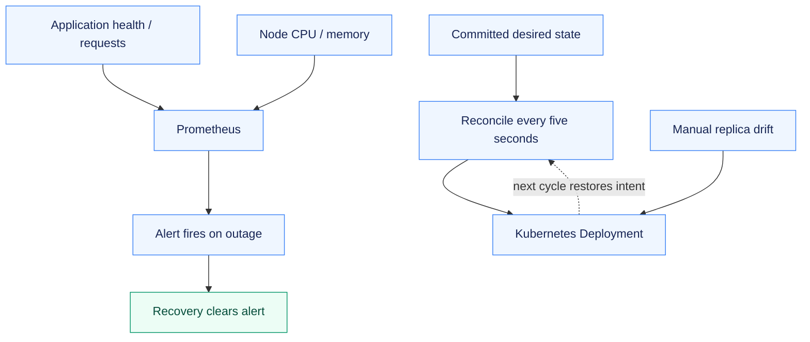
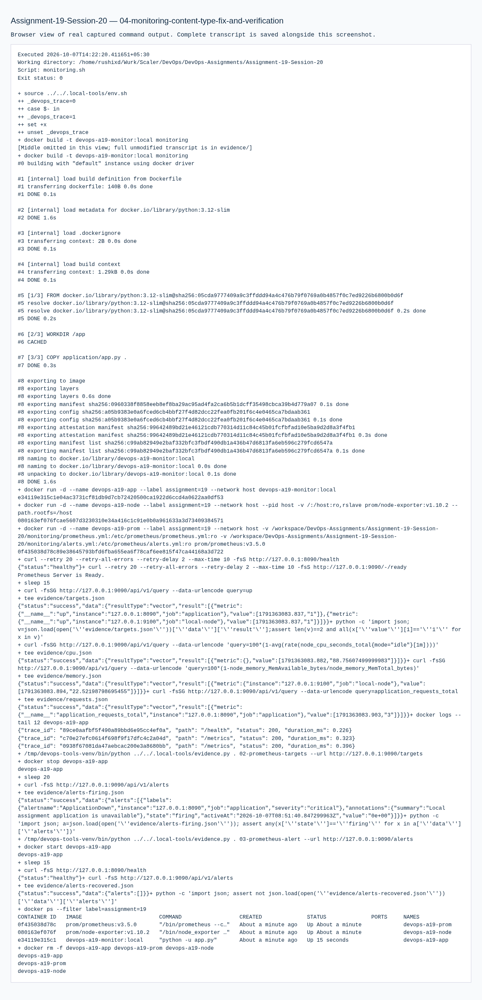

# Assignment 19 — Monitoring, Alerts & Local GitOps

Application and host monitoring, alert recovery and continuous reconciliation from committed Git state.

[Portfolio](../README.md) · [Requirements](REQUIREMENTS.md) · [Execution evidence](evidence/)

## The problem

A running service needs observable health and recovery signals. Its live configuration should also converge back to versioned desired state after manual changes.

## Approach

1. Collected application requests/health and VM CPU/memory through Prometheus and node-exporter.
2. Induced an outage, observed a firing alert, restored the target and checked alert recovery.
3. Reconciled a Deployment from committed local Git every five seconds, proving drift correction and promotion through a new commit.

## How it works



## Implementation

| Component | Implementation | Behavior verified |
| --- | --- | --- |
| Monitoring demo | [monitoring/](monitoring/) | Application health/request metrics and VM CPU/memory via Prometheus and node-exporter. |
| Actual alert and recovery | [evidence/04-monitoring-content-type-fix-and-verification.md](evidence/04-monitoring-content-type-fix-and-verification.md) | Target outage produces a firing alert; restored target clears it. |
| Observability documentation | [observability.md](observability.md) | Metrics/logs/traces, tools and Kubernetes diagnosis. |
| GitOps demonstration | [gitops/](gitops/) | Five-second reconciliation corrects manual drift and deploys a newly committed version. |

**Tools:** Prometheus, node-exporter, Python application metrics, Docker, local Git and kubectl.

## Commands used

These are representative recorded commands. Complete scripts and output are linked in the evidence section.

```bash
curl -fsS http://127.0.0.1:9090/api/v1/alerts
git log --oneline
kubectl get deployments
```

## Verification & results

Real targets became UP, metrics queries returned data, the induced outage fired an alert and recovery cleared it. Local Git drift correction and a committed version change were observed; the Git bundle preserves the history.

The linked records identify the original local execution environment. Privileged Docker/Minikube exercises used the prepared Ubuntu VM; application endpoints shown in that evidence are historical.

## GitOps workflow demonstrated

The controller reads the Deployment committed on local Git `main` every five seconds and applies that desired state. Uncommitted file edits are not its source. The exercise changed live replicas manually and observed correction; a new commit then promoted the real application version. No GitHub repository or cloud cluster was required for this PDF exercise.

The desired state is declarative, versioned and repeatedly reconciled. A successful one-time apply is not the same behavior as continuous reconciliation.

## Troubleshooting & decisions

Prometheus required the correct metrics Content-Type. Trace IDs in request logs are useful correlation, but this exercise does not claim a distributed trace collector.

## Evidence

- [01 monitoring health alert and recovery](evidence/01-monitoring-health-alert-and-recovery.md) — retained earlier attempt / diagnosis; use the successful retry for completion
- [04 monitoring content type fix and verification](evidence/04-monitoring-content-type-fix-and-verification.md) — successful execution
- [05 local gitops reconciliation](evidence/05-local-gitops-reconciliation.md) — successful execution

## Screenshots

Actual application pages and recorded command-output views from the practical execution.


<details>
<summary>More screenshots: implementation, diagnostics and verification</summary>





</details>

## Key takeaways

Metrics, logs and alerts provide different operational signals. GitOps uses committed desired state and ongoing reconciliation; uncommitted file changes are not a release.
