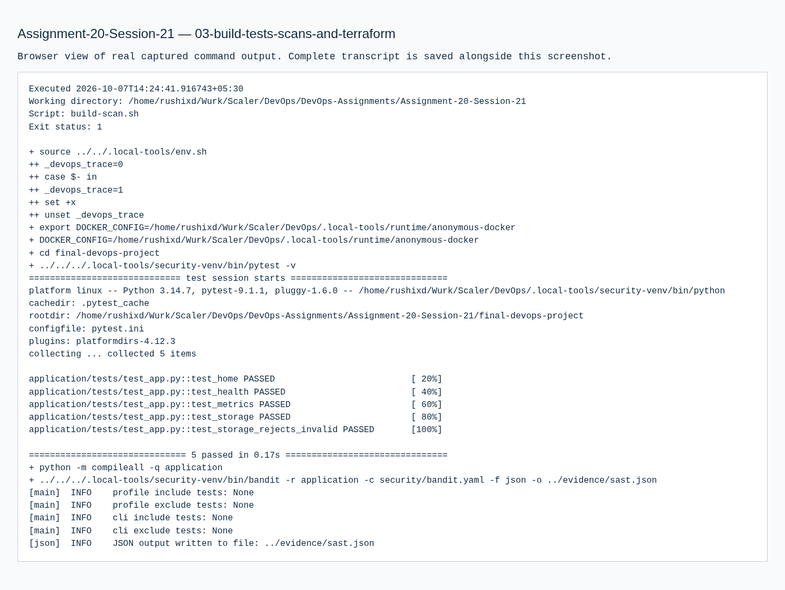
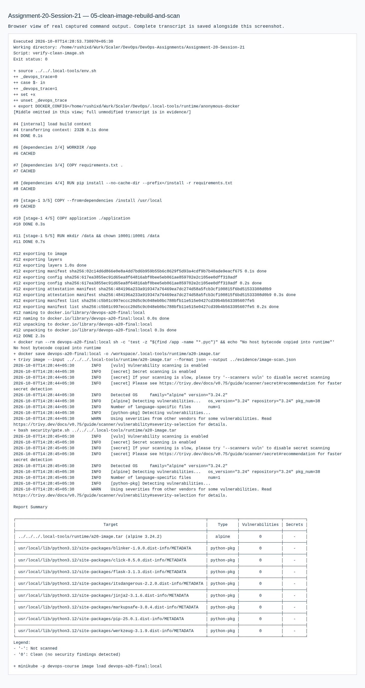
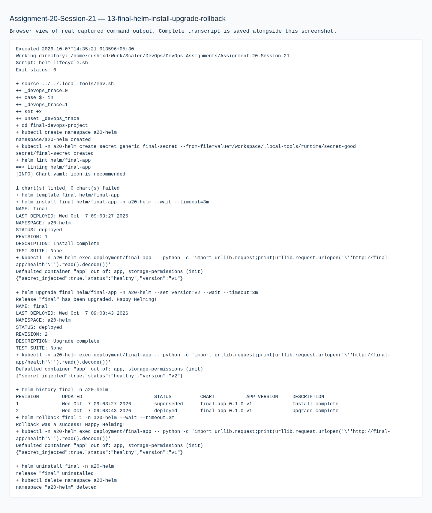
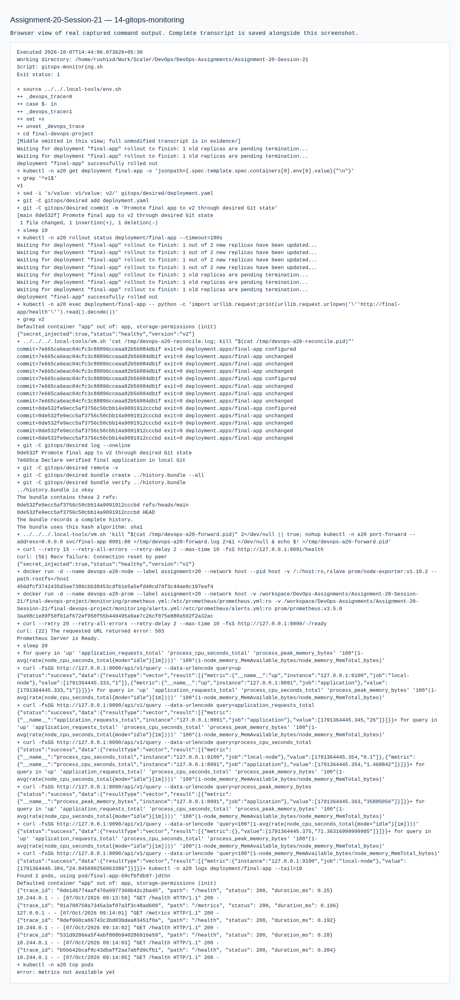
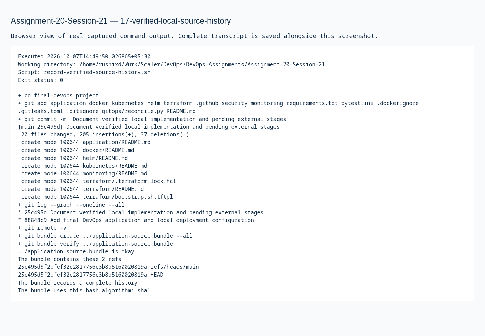
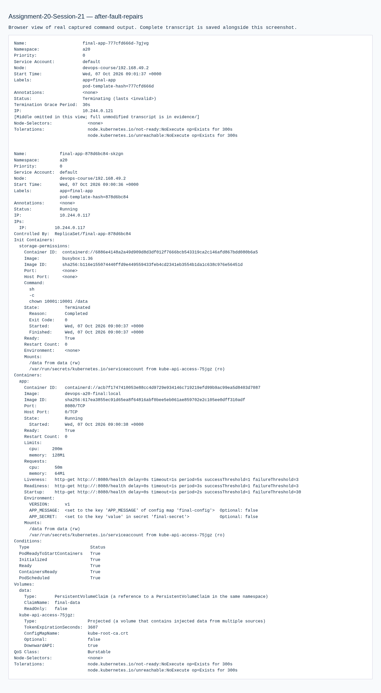

# 20 · Final DevOps Project & Troubleshooting

**Session 21** · **Local work verified · required stages pending**

[Portfolio](../README.md) · [Exact requirements](REQUIREMENTS.md) · [Submission readiness](../SUBMISSION_READINESS.md)

> Integrate the complete local Flask DevOps project and compare its PDF coverage with the separately verified Release Helpdesk cloud capstone. These are distinct applications and their evidence is identified separately.

| Assignment record | Details |
| --- | --- |
| PDF source | DevOps Homework.pdf · pages 49, 50, 51, 52, 53, 54 |
| Student | Rushi Jadhav · 10144 |
| Evidence | Successful transcripts: 11 · actual screenshots: 21 |
| Execution environment | Original local host / Ubuntu VM as identified in the transcripts |
| Review | 21 October 2026; historical output is retained unchanged |

## Requirement coverage

| PDF requirement | Implementation / document | Demonstrated behavior |
| --- | --- | --- |
| Exact final project structure | [final-devops-project/](final-devops-project/) | application, docker, kubernetes, helm, terraform, .github/workflows, security, monitoring, gitops and README. |
| Local tests / four scanner categories | [evidence/04-build-scans-validated-after-storage-fix.md](evidence/04-build-scans-validated-after-storage-fix.md) | Real application tests, SAST/SCA/secret scan and strict container gate. |
| Kubernetes and Helm | [evidence/10-kubernetes-storage-hpa-fault-repair.md](evidence/10-kubernetes-storage-hpa-fault-repair.md) | ConfigMap/hidden Secret, Ingress, all probes, persistent storage, HPA and multiple repaired failures; Helm lifecycle also recorded. |
| Monitoring and GitOps | [evidence/15-final-monitoring-verification.md](evidence/15-final-monitoring-verification.md) | Actual metrics/alert recovery and continuously reconciled local desired state. |
| Separate Release Helpdesk cloud record | [Public capstone](https://github.com/NoteLegend/devOps-TaskBoard) | Real CI/GHCR/EKS/ALB/PostgreSQL/HPA/monitoring/teardown evidence exists for that different capstone. |

## Commands and verification

Key commands are shown below. The evidence records contain the complete executed scripts, exact resource names, output and exit status.

```bash
cd final-devops-project
python -m pytest -v
docker build -t devops-a20-final:local -f docker/Dockerfile .
helm lint helm/final-app
cd terraform
terraform validate
```

[Reproduction and tooling](../REPRODUCING.md) explains the original VM adapters, native-tool use and portable Git bundles. Full executed scripts and stdout/stderr are linked below.

## Observed result

The Flask project’s permitted local stages passed. Its saved scans report 0 SAST/SCA/secret findings and 0 image HIGH/CRITICAL at capture time. Separately, Release Helpdesk records 19 tests, a successful hosted deployment and AWS HPA 2 → 4 → 2, followed by teardown.

## Troubleshooting and observations

A successful deployment of one application cannot silently substitute for another application’s missing pipeline or infrastructure stage. Release Helpdesk currently has image scanning and CI-driven Helm delivery, but no SAST job or continuous GitOps controller; dependency analysis is inside Trivy and the secret scan is a separate historical record.

## Recorded repairs

| Failure introduced or observed | Investigation / root cause | Verified correction |
| --- | --- | --- |
| Invalid image tag | Pod status/events show image retrieval failure | Restore the verified local image and wait for rollout |
| Bad readiness path | Running process returns no health response at the configured endpoint | Restore `/health`; new replicas become ready |
| Wrong Service selector | Selected endpoints are empty and HTTP fails | Match Pod labels; HTTP succeeds |
| Predictable temporary storage default | Bandit B108 flags the original `/tmp` fallback | Use configured/relative storage and validate before writes; tests/SAST pass |
| Monitoring target disconnected | Port-forward interruption makes scrape health fail while Pods can remain healthy | Restore the forward; actual firing alert clears |

The first post-GitOps `kubectl top` ran before metrics-server had sampled replacement Pods. The follow-up used bounded retries, captured actual CPU/memory and finished successfully. All original failed output is preserved.

## Submission status

**BLOCKED.** Finish one coherent capstone: either execute the Flask project’s approved hosted/registry/cloud stages, or integrate SAST, continuous GitOps and the required submission layout into Release Helpdesk, with explicit traceability for its existing dependency and secret-scan checks. Preserve proof from the same project and revision. No new AWS deployment is needed merely to document its already-recorded EKS run.

## Execution evidence

- [01 source git initialization](evidence/01-source-git-initialization.md) — successful execution
- [03 build tests scans and terraform](evidence/03-build-tests-scans-and-terraform.md) — retained earlier attempt / diagnosis; use the successful retry for completion
- [04 build scans validated after storage fix](evidence/04-build-scans-validated-after-storage-fix.md) — successful execution
- [05 clean image rebuild and scan](evidence/05-clean-image-rebuild-and-scan.md) — successful execution
- [08 real docker smoke test](evidence/08-real-docker-smoke-test.md) — successful execution
- [10 kubernetes storage hpa fault repair](evidence/10-kubernetes-storage-hpa-fault-repair.md) — successful execution
- [11 cloud bootstrap local validation](evidence/11-cloud-bootstrap-local-validation.md) — successful execution
- [12 cloud application template validation](evidence/12-cloud-application-template-validation.md) — successful execution
- [13 final helm install upgrade rollback](evidence/13-final-helm-install-upgrade-rollback.md) — successful execution
- [14 gitops monitoring](evidence/14-gitops-monitoring.md) — retained earlier attempt / diagnosis; use the successful retry for completion
- [15 final monitoring verification](evidence/15-final-monitoring-verification.md) — successful execution
- [16 scanned image artifact identity](evidence/16-scanned-image-artifact-identity.md) — successful execution
- [17 verified local source history](evidence/17-verified-local-source-history.md) — successful execution

## Screenshots

Actual application pages and explicitly labelled views of captured command output. Full text records preserve output omitted from an image.

<details>
<summary>Open the screenshot gallery (21 images)</summary>


















</details>
