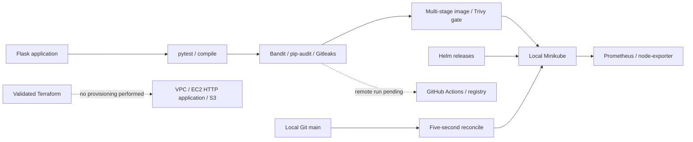

# Final DevOps Project · Local Integration

**Rushi Jadhav · Enrollment 10144 · Session 21**

[Assignment overview](../README.md) · [Exact PDF requirements](../REQUIREMENTS.md) · [Submission readiness](../../SUBMISSION_READINESS.md)

> A Flask application carried through tests, security scans, a multi-stage image, local Kubernetes, Helm, monitoring and continuous GitOps reconciliation.

| Verified locally | Still required for this project |
| --- | --- |
| Tests, SAST/SCA/secret/image scans and strict vulnerability gate | Its own successful hosted CI/CD and image publication |
| Ingress, HPA, Secret/ConfigMap, all probes and persistence | Approved cloud execution and genuine same-project infrastructure evidence |
| Helm upgrade/rollback and multiple failure repairs | Final publication and instructor handover |
| Actual metrics, alert/recovery and local GitOps drift correction | A single coherent end-to-end submission |

The separate [Release Helpdesk repository](https://github.com/NoteLegend/devOps-TaskBoard) has a real AWS/EKS deployment record. Its source and images differ from this Flask project; those results are not presented as this project’s missing external execution. [The final checklist](../../SUBMISSION_READINESS.md) explains both completion routes.

## Overview and architecture

## Technologies and application setup

The app exposes `/`, `/health`, `/metrics`, `/load` and `/storage`. Unit tests cover actual health/header, metrics, valid persistence and invalid input. Flask dependencies are declared in requirements.txt. Run `python -m pytest -v` in this subproject with those dependencies installed. The bounded load endpoint supplies real CPU work for HPA. Runtime configuration comes from APP_MESSAGE, VERSION, APP_SECRET and DATA_DIR; health reports only whether a Secret is present. This classroom demo uses Flask's development HTTP server, not a claimed production server.

## Docker setup

`docker/Dockerfile` installs dependencies in a separate stage, copies them into the runtime, uses UID 10001 and exposes 8080. The actual local build is `docker build -t devops-a20-final:local -f docker/Dockerfile .`. The image was imported into the local Minikube profile; no registry push was used to deploy it.

## Kubernetes deployment

`kubernetes/` declares the ConfigMap, PVC, Deployment, Service, Ingress and HPA. `secret.yaml.example` is a placeholder; verification created the real temporary Secret from a file outside the submission. The workload uses startup/readiness/liveness health checks and an assignment-owned PVC with an init container setting storage ownership. Local ingress host is final.local. A real stored marker was read after Pod replacement, and HTTP CPU load caused scaling. Exact resource changes and responses are in the Kubernetes troubleshooting transcript.

## Helm deployment

`helm/final-app` packages those resources with image/version/message/host values. The Secret is supplied at runtime. Verification performed lint/template, install, v2 upgrade, history, rollback to v1 and uninstall in an isolated namespace. Those changes were checked using actual health responses.

## Terraform infrastructure

`terraform/` prepares VPC/subnet/Internet Gateway/routes, an HTTP-only inbound Security Group, EC2 with encrypted root/IMDSv2, and protected S3. A template installs Docker on an owner-selected Ubuntu 24.04 amd64 AMI and runs the owner-published public final image with persistent host storage. Init, fmt/check and validate were executed; no plan/apply/state inspection/destroy was run. The cloud bootstrap was checked for Bash syntax and the configuration was validated locally; it was never executed in AWS. AMI, bucket and registry-image inputs remain owner placeholders. Public addressing/HTTP and any associated costs require explicit owner review. Actual cloud provisioning requires explicit approval and separate verification.

## CI/CD pipeline

`.github/workflows/pipeline.yml` orders compile, unit tests, SAST, SCA, secrets, Docker build, image gate, then an artifact transfer of that exact scanned image to owner-gated registry publication and Kubernetes deployment. Local save/load/tag checks verified the image ID stayed identical. The future job refers to registry, KUBECONFIG_DATA and APP_SECRET secrets by name. No values are supplied or committed. Workflows were linted locally, and corresponding local stages ran. A repository-root manual entry point is now prepared at ../../.github/workflows/assignment-20-final.yml for the combined submission; the nested file remains the standalone template. Hosted success screenshots and authenticated delivery remain pending.

## DevSecOps

Bandit scans app code excluding tests; pip-audit checks declared dependencies; Gitleaks scans the source with redaction. Trivy retains a full image report and gates all HIGH/CRITICAL vulnerabilities, including unfixed findings. The actual reports remain in ../evidence; no remote scan run is claimed.

## Monitoring

Prometheus scrapes the actual forwarded application metrics plus VM node-exporter. Evidence includes request count, process CPU/peak memory, VM CPU/memory, workload logs, `kubectl top` and real browser targets/alerts pages. JSON request logs have trace IDs and durations; no distributed trace collector is claimed. Disconnecting the local monitoring transport fired the scrape alert; restoration cleared it.

## GitOps

`gitops/desired` contains committed Deployment state. The controller applies committed main every five seconds; manual version drift was corrected, then a new commit changed the application's actual version. The HPA owns replicas, so desired Git state omits replica count. `gitops/history.bundle` preserves local commits; no remote or push was used. This is an educational reconciler, not an Argo CD/Flux claim.

## Troubleshooting and lessons

Image/tag, readiness endpoint and Service selector faults were introduced, diagnosed using actual Pods/events/logs/endpoints, repaired and verified over HTTP. [Assignment 20](../README.md) embeds real application, monitoring and command screenshots and links all before/after evidence. Check application behavior after configuration success; preserve actual failure output and separate local verification from unexecuted external stages.

## Evidence gallery

The [assignment README](../README.md#screenshots) embeds all original local screenshots and links complete recorded scripts/output. The HTTP/storage checks, real HPA measurements, Helm revisions, scanner reports and GitOps commits remain in the assignment evidence directory. Dates and failures are preserved.
