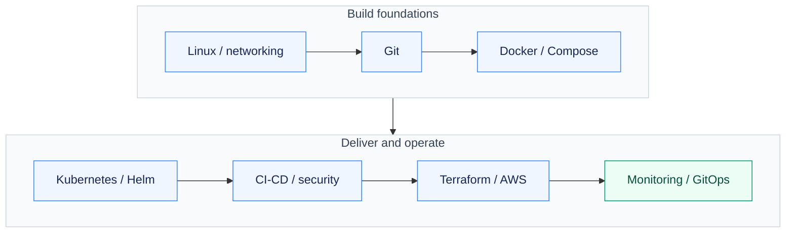

# DevOps Practical Projects

Build, deploy, diagnose and verify—from Linux fundamentals to automated delivery and cloud infrastructure.

[Explore the assignments](#assignment-map) · [Verification](#verification) · [Evidence guide](REPRODUCING.md) · [Capstone](https://github.com/NoteLegend/devOps-TaskBoard)

## From system commands to operated services

Each assignment is presented as a practical case study: the problem, the approach, the system or workflow, the implementation and the observed result. Diagrams explain the design; commands, logs and screenshots establish what actually worked.

The course has 21 sessions across **20 assignments**: Sessions 1 and 2 share Assignment 01. Assignments 01–19 contain the practical work and evidence; Assignment 20 links the existing TaskBoard capstone.

## Assignment map

| Assignment | Session | Project focus | Demonstrated outcome |
| --- | --- | --- | --- |
| [01](Assignment-01-Session-01-02/README.md) | 01-02 | Linux & Shell Automation | System inspection and a repeatable shell report |
| [02](Assignment-02-Session-03/README.md) | 03 | Networking & Connectivity Diagnosis | Layered connectivity checks and DNS packet capture |
| [03](Assignment-03-Session-04/README.md) | 04 | Git Branching & Selective Integration | Staging behavior, feature branches and cherry-pick |
| [04](Assignment-04-Session-05/README.md) | 05 | Six Containerized Hello World Applications | Six built and HTTP/browser-verified applications |
| [05](Assignment-05-Session-06/README.md) | 06 | Docker Multi-Stage Build | Builder/runtime stages and port-8080 verification |
| [06](Assignment-06-Session-07/README.md) | 07 | Docker Network Isolation & Bind Mounts | Network isolation and live bind-mounted updates |
| [07](Assignment-07-Session-08/README.md) | 08 | Docker Compose & Service Readiness | Three Compose examples and startup-readiness repair |
| [08](Assignment-08-Session-09/README.md) | 09 | Kubernetes Fundamentals on Minikube | Deploy, expose, scale, update and recover |
| [09](Assignment-09-Session-10/README.md) | 10 | Kubernetes Releases & Pod Lifecycle | Four rollout strategies and twelve lifecycle cases |
| [10](Assignment-10-Session-11/README.md) | 11 | Kubernetes Services & DNS | Five Service types and actual DNS/HTTP behavior |
| [11](Assignment-11-Session-12/README.md) | 12 | Configuration, Secrets & Ingress | Runtime configuration, Ingress and newline diagnosis |
| [12](Assignment-12-Session-13/README.md) | 13 | Kubernetes Storage, Autoscaling & Probes | Persistent data, health probes and HPA recovery |
| [13](Assignment-13-Session-14/README.md) | 14 | Kubernetes Troubleshooting | Faults diagnosed and repaired with before/after proof |
| [14](Assignment-14-Session-15/README.md) | 15 | Helm Packaging, Upgrades & Rollback | Chart packaging, upgrades and working rollback |
| [15](Assignment-15-Session-16/README.md) | 16 | Calculator CI/CD with GitHub Actions | Successful calculator CI and CD with GHCR delivery |
| [16](Assignment-16-Session-17/README.md) | 17 | Security-Gated CI/CD & Kubernetes Delivery | Four security gates and verified Kubernetes delivery |
| [17](Assignment-17-Session-18/README.md) | 18 | Terraform S3 Lifecycle & AWS Foundations | Real S3 lifecycle and five AWS research documents |
| [18](Assignment-18-Session-19/README.md) | 19 | Terraform VPC, EC2 & S3 Infrastructure | Real VPC/EC2/S3 lifecycle with verified cleanup |
| [19](Assignment-19-Session-20/README.md) | 20 | Monitoring, Alerts & Local GitOps | Metrics, alert recovery and committed-state reconciliation |
| [20](Assignment-20-Session-21/README.md) | 21 | Final DevOps Project | Existing Release Helpdesk project repository |

## Verification

| Area | Result and evidence |
| --- | --- |
| Application delivery | The calculator passed five tests and separate hosted [CI](https://github.com/NoteLegend/DevOps-Assignments/actions/runs/39584561631) and [CD](https://github.com/NoteLegend/DevOps-Assignments/actions/runs/39584567670) workflows. CD executed and published its verified image. |
| DevSecOps | The [successful complete pipeline](https://github.com/NoteLegend/DevOps-Assignments/actions/runs/39584880376) passed source, dependency, secret and image gates, published to GHCR, verified two Ready Kubernetes replicas and HTTP health, then removed its temporary cluster. |
| Terraform / AWS | [S3 lifecycle](Assignment-17-Session-18/evidence/aws-lifecycle-summary.json): two resources created, inspected and destroyed. [EC2/S3 lifecycle](Assignment-18-Session-19/evidence/aws-lifecycle-summary.json): six resources created, checked and destroyed; root-disk deletion also verified. |
| Kubernetes operations | Recorded exercises cover release strategies, discovery, routing, persistence, probes, scaling, Helm rollback and deliberate failure recovery. |

## Reading the evidence

The assignment READMEs link implementation files, complete execution records and actual screenshots. Successful retries are distinguished from earlier failures, and the records identify their environments and dates. Original privileged exercises used the prepared Ubuntu VM/Minikube; the later hosted and AWS records are labelled separately. Historical endpoints are not presented as currently running services.

The source requirements remain in each assignment's `REQUIREMENTS.md`, mapped from the original **DevOps Homework.pdf**. [Requirement coverage](REQUIREMENT_COVERAGE.md), [status](ASSIGNMENT_STATUS.md), [reproduction notes](REPRODUCING.md) and the [submission audit](AUDIT.md) provide the detailed review trail.
