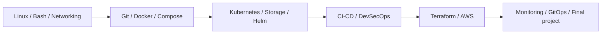

# DevOps Practical Portfolio

**Rushi Jadhav · Enrollment 10144**
**21 course sessions · 20 assignments · PDF-based requirement mapping**

> From Linux and Git to containers, Kubernetes, security, infrastructure and operations. Each assignment links its implementation to actual command output and screenshots.

[Assignment status](ASSIGNMENT_STATUS.md) · [Final submission checklist](SUBMISSION_READINESS.md) · [PDF coverage](REQUIREMENT_COVERAGE.md) · [Reproduction guide](REPRODUCING.md)

## Submission at a glance

| Scope | Current finding |
| --- | --- |
| Assignment structure | Exactly 20 folders; Sessions 1 and 2 are combined in Assignment 01 |
| Verified practical work | Assignments 01–14 and 19 |
| Required work still pending | Assignments 15–18 and 20; precise gaps are listed in the final submission checklist |
| Public portfolio | [NoteLegend/DevOps-Assignments](https://github.com/NoteLegend/DevOps-Assignments) exists; this local refresh is not published yet |
| Separate cloud capstone | [Release Helpdesk](https://github.com/NoteLegend/devOps-TaskBoard) has genuine CI, registry, AWS/EKS and teardown evidence |
| Last review | 21 October 2026; recorded execution and current source were reviewed, without creating cloud resources |

**The portfolio is not yet ready to claim 20/20 complete.** Existing Release Helpdesk cloud evidence is recognized, while assignment-specific and same-project integration gaps remain visible.

## Course pathway

## Assignment index

| Assignment | Course session | Topic | Review outcome |
| --- | --- | --- | --- |
| [01](Assignment-01-Session-01-02/README.md) | 01-02 | Linux Homework Tasks and Shell Scripting Homework Task | Verified practical |
| [02](Assignment-02-Session-03/README.md) | 03 | Networking Homework Tasks | Verified practical |
| [03](Assignment-03-Session-04/README.md) | 04 | Git Homework Tasks | Verified practical |
| [04](Assignment-04-Session-05/README.md) | 05 | Docker Hello World Applications | Verified practical |
| [05](Assignment-05-Session-06/README.md) | 06 | Docker Multi-Stage Build | Verified practical |
| [06](Assignment-06-Session-07/README.md) | 07 | Docker Networking & Volume | Verified practical |
| [07](Assignment-07-Session-08/README.md) | 08 | Docker Networking & Volume: remaining session exercises | Verified practical |
| [08](Assignment-08-Session-09/README.md) | 09 | Kubernetes Fundamentals | Verified practical |
| [09](Assignment-09-Session-10/README.md) | 10 | Kubernetes Pods, ReplicaSets & Deployments | Verified practical |
| [10](Assignment-10-Session-11/README.md) | 11 | Kubernetes Networking & Services | Verified practical |
| [11](Assignment-11-Session-12/README.md) | 12 | Kubernetes Ingress, ConfigMaps & Secrets | Verified practical |
| [12](Assignment-12-Session-13/README.md) | 13 | Kubernetes Storage, HPA & Probes | Verified practical |
| [13](Assignment-13-Session-14/README.md) | 14 | Kubernetes Troubleshooting | Verified practical |
| [14](Assignment-14-Session-15/README.md) | 15 | Helm | Verified practical |
| [15](Assignment-15-Session-16/README.md) | 16 | CI/CD & GitHub Actions | Required stages pending |
| [16](Assignment-16-Session-17/README.md) | 17 | Complete CI/CD & DevSecOps | Required stages pending |
| [17](Assignment-17-Session-18/README.md) | 18 | Terraform & Infrastructure as Code | Required stages pending |
| [18](Assignment-18-Session-19/README.md) | 19 | Cloud & Terraform in Action | Required stages pending |
| [19](Assignment-19-Session-20/README.md) | 20 | Monitoring, Observability & GitOps | Verified practical |
| [20](Assignment-20-Session-21/README.md) | 21 | Final DevOps Project & Troubleshooting | Required stages pending |

## How to review an assignment

Open its README for the PDF coverage table, implementation links, observed results and pending requirements. The execution records retain complete scripts, stdout/stderr and exit status. The collapsible screenshot gallery embeds real evidence using relative paths. Deliberate faults and unsuccessful attempts are preserved alongside successful repairs.

The authoritative source is the 54-page **DevOps Homework.pdf** in the parent workspace. Each assignment’s REQUIREMENTS.md preserves its mapped text. Session 8 uses the page-10 remaining-exercises instruction and the instructor’s referenced Compose material; it is not inferred from page count.

## Technologies

| Foundation | Delivery | Infrastructure and operations |
| --- | --- | --- |
| Linux · Bash · Networking · Git | Docker · Compose · GitHub Actions · Bandit · pip-audit · Gitleaks · Trivy | Minikube · Kubernetes · Helm · Terraform · AWS · Prometheus · GitOps |

Original privileged exercises used the prepared Ubuntu VM; the transcripts identify that environment. Release Helpdesk’s later local-kind and AWS records are labelled independently. [Environment and recorded versions](EXECUTION_ENVIRONMENT.md) · [Tool inventory](TOOL_INVENTORY.md) · [Local Git history](LOCAL_GIT_HISTORY.md).

## Final submission

1. Finish the five assignments with outstanding requirements using [the exact checklist](SUBMISSION_READINESS.md).
2. Keep genuine results with the project/version that produced them; do not reuse another application’s hosted run as proof.
3. Review [the static audit](AUDIT.md), then publish the updated assignment repository yourself and submit its URL together with the relevant capstone evidence.
