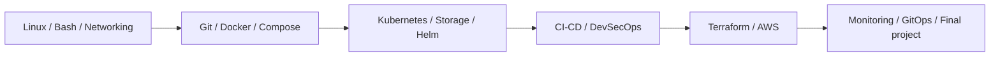

# DevOps Practical Portfolio

**Rushi Jadhav · Enrollment 10144**

**21 sessions · 20 assignments · 20 complete · 0 with required work pending**

> A practical path from Linux and Git to containers, Kubernetes, security, infrastructure and operations. Implementations are linked to actual command output, screenshots and dated verification.

[Assignment status](ASSIGNMENT_STATUS.md) · [Submission checklist](SUBMISSION_READINESS.md) · [PDF coverage](REQUIREMENT_COVERAGE.md) · [Reproduction](REPRODUCING.md) · [Audit](AUDIT.md)

## Submission at a glance

| Scope | Current record |
| --- | --- |
| Authoritative instructions | 54-page DevOps Homework.pdf in the original workspace; exact mapped excerpts in each REQUIREMENTS.md |
| Folder mapping | Exactly 20 assignments: Sessions 1 and 2 combined, then one assignment per Session 3–21 |
| Publication | Updated source and evidence pushed to the existing [assignment repository](https://github.com/NoteLegend/DevOps-Assignments) with owner approval |
| Capstone | [Release Helpdesk](https://github.com/NoteLegend/devOps-TaskBoard), with real GitHub/GHCR, local Flux and historical AWS/EKS lifecycle evidence |
| Review date | 21 October 2026; evidence dates and revisions are kept explicit |

## Course pathway

## Assignment index

| Assignment | Session | Topic | Status |
| --- | --- | --- | --- |
| [01](Assignment-01-Session-01-02/README.md) | 01-02 | Linux Homework Tasks and Shell Scripting Homework Task | COMPLETE |
| [02](Assignment-02-Session-03/README.md) | 03 | Networking Homework Tasks | COMPLETE |
| [03](Assignment-03-Session-04/README.md) | 04 | Git Homework Tasks | COMPLETE |
| [04](Assignment-04-Session-05/README.md) | 05 | Docker Hello World Applications | COMPLETE |
| [05](Assignment-05-Session-06/README.md) | 06 | Docker Multi-Stage Build | COMPLETE |
| [06](Assignment-06-Session-07/README.md) | 07 | Docker Networking & Volume | COMPLETE |
| [07](Assignment-07-Session-08/README.md) | 08 | Docker Networking & Volume: remaining session exercises | COMPLETE |
| [08](Assignment-08-Session-09/README.md) | 09 | Kubernetes Fundamentals | COMPLETE |
| [09](Assignment-09-Session-10/README.md) | 10 | Kubernetes Pods, ReplicaSets & Deployments | COMPLETE |
| [10](Assignment-10-Session-11/README.md) | 11 | Kubernetes Networking & Services | COMPLETE |
| [11](Assignment-11-Session-12/README.md) | 12 | Kubernetes Ingress, ConfigMaps & Secrets | COMPLETE |
| [12](Assignment-12-Session-13/README.md) | 13 | Kubernetes Storage, HPA & Probes | COMPLETE |
| [13](Assignment-13-Session-14/README.md) | 14 | Kubernetes Troubleshooting | COMPLETE |
| [14](Assignment-14-Session-15/README.md) | 15 | Helm | COMPLETE |
| [15](Assignment-15-Session-16/README.md) | 16 | CI/CD & GitHub Actions | COMPLETE |
| [16](Assignment-16-Session-17/README.md) | 17 | Complete CI/CD & DevSecOps | COMPLETE |
| [17](Assignment-17-Session-18/README.md) | 18 | Terraform & Infrastructure as Code | COMPLETE |
| [18](Assignment-18-Session-19/README.md) | 19 | Cloud & Terraform in Action | COMPLETE |
| [19](Assignment-19-Session-20/README.md) | 20 | Monitoring, Observability & GitOps | COMPLETE |
| [20](Assignment-20-Session-21/README.md) | 21 | Final DevOps Project & Troubleshooting | COMPLETE |

## Reviewing the work

Each README connects the PDF requirements to source files, significant commands, observed results and embedded screenshots. Complete execution records retain stdout/stderr and exit status; failures remain alongside their verified fixes. Original Ubuntu/Minikube, later host Docker/kind, hosted runner and historical cloud results are labelled by environment.

Session 8 follows the PDF’s page-10 remaining-exercises instruction and the referenced Compose examples. Sessions were mapped from the course content, rather than one assignment per PDF page.

## Technologies

| Foundations | Delivery and security | Infrastructure and operations |
| --- | --- | --- |
| Linux · Bash · Networking · Git | Docker · Compose · GitHub Actions · Bandit · Semgrep · pip-audit · Gitleaks · Trivy | Minikube · Kubernetes · Helm · Terraform · AWS · Prometheus · Grafana · Flux |

[Environment](EXECUTION_ENVIRONMENT.md) · [Tools](TOOL_INVENTORY.md) · [Exercise Git histories](LOCAL_GIT_HISTORY.md) · [Identity](IDENTITY.md)

## Submission

Review the [remaining requirements](SUBMISSION_READINESS.md) and [audit](AUDIT.md), then submit the existing repository URL and the required assignment evidence. Cloud demonstrations include their actual teardown records; historical endpoints are not presented as live services.
